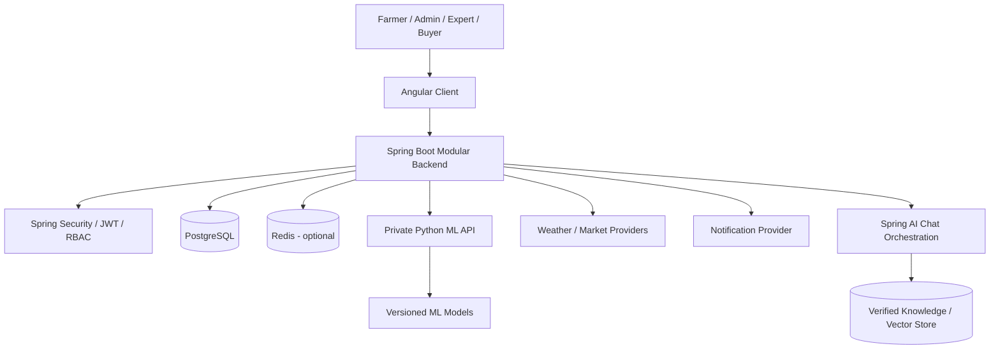

# System Architecture

## Logical components

## Trust boundaries
- Browser is an untrusted client. Enforce all authorization on the backend.
- Python inference endpoints are internal and must not be publicly exposed to the browser.
- LLM tools must call authorized backend services; never allow raw database access or authorization bypass.
- External provider data must be validated, timestamped and attributed.

## Architecture decision records
Create `docs/architecture/decisions/ADR-0001-*.md` for significant choices. Each ADR should include context, decision, alternatives, consequences and date.
