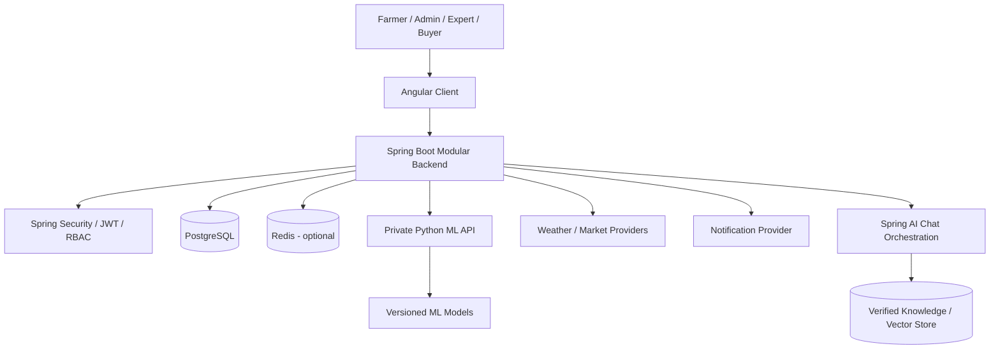

# System Architecture

## Logical components



## Trust boundaries
- Browser is an untrusted client. Enforce all authorization on the backend.
- Python inference endpoints are internal and must not be publicly exposed to the browser. Every `/v1/**` call from the backend carries the shared `X-Internal-Api-Key` (ADR-0004); the ML service rejects anything else with 401 and listens only on loopback.
- LLM tools must call authorized backend services; never allow raw database access or authorization bypass.
- External provider data must be validated, timestamped and attributed.

## Spring Boot backend (`backend/`)
- Spring Boot 4.1.2 modular monolith (ADR-0001, ADR-0002), package root `com.agrigenius`.
- Shared code: `common/error` (problem+json errors), `common/security` (JSON 401/403), `common/web` (`X-Request-Id` correlation), `config` (security, CORS, OpenAPI).
- Feature modules arrive as packages with `api` (controllers, DTOs) → `application` (services, transactions) → `domain` (entities) → `infrastructure` (repositories, adapters). Modules talk through `application` services only, never another module's repositories.
- Persistence: PostgreSQL 17 + pgvector via JPA/Hibernate (`ddl-auto=validate`, `open-in-view=false`, UTC). Flyway owns the schema; `clean` is disabled.
- Database privileges: Flyway connects as the schema owner (`POSTGRES_USER`). The running application connects as a least-privilege role (`DB_USERNAME`, default `agrigenius_app`) that can only read and write rows. Flyway's `afterMigrate.sql` callback creates or updates that role and its grants after every migration (disable with `DB_MANAGE_APP_ROLE=false` where roles are provisioned externally).
- Security: stateless, CSRF off (no cookies), deny by default. Public: `POST /api/auth/register`, `POST /api/auth/login`, health, liveness, readiness, info, and API docs in the `local` profile only. Everything else needs a valid JWT bearer token (ADR-0003). CORS allowlist from `CORS_ALLOWED_ORIGINS` for `/api/**`.

### Identity and farmer modules (Milestone 2)

- `identity`: user accounts (`users`), roles, password hashing (BCrypt cost 12), login, access-token issuing (`AccessTokenService`) and verification (`JwtConfig`), login/registration throttling.
- `farmer`: farmer profiles (`farmer_profiles`), registration and `GET /api/farmers/me`.
- Dependency direction: `farmer` → `identity` (through `identity.application` services), never the reverse. Registration lives in the `farmer` module because it creates the user and the farmer profile in one transaction.

```
POST /api/auth/register ─► farmer: FarmerRegistrationService (@Transactional)
                              ├─► identity: UserAccountService.createAccount(..., FARMER) ─► users (BCrypt hash)
                              └─► FarmerProfileRepository ─► farmer_profiles
POST /api/auth/login    ─► identity: AuthenticationManager (DaoAuthenticationProvider)
                              └─► AccessTokenService ─► HS256 JWT (iss, aud, sub, roles, iat, nbf, exp, jti)
GET  /api/farmers/me    ─► BearerTokenAuthenticationFilter ─► JwtDecoder (signature, alg, iss, aud, exp/nbf)
                              └─► roles claim → ROLE_FARMER ─► FarmerProfileService (re-checks account is ACTIVE)
```

- Bearer tokens are ignored on `/api/auth/**`, so a stale or expired token in the client cannot break login or registration.
- Tokens carry no personal data. They remain valid until expiry (30 minutes); endpoints that matter re-check account status.
- Throttling (5 failed logins per number, 20 auth requests per IP, per 15 minutes) is in-memory, so it is per instance.
- ML integration: `integration/ml/MlServiceClient` (port) with a `RestClient` adapter, 2 s connect / 5 s read timeouts. The `mlService` health component reports `DEGRADED` (never `DOWN`) when the ML service is unreachable and is excluded from readiness, so the backend keeps serving non-ML features.
- Anonymous health results are cached for 10 s so public health checks cannot be used to flood the database or ML service.

### Recommendation module (Milestone 3, in progress)

- `recommendation`: crop recommendation requests and results, the crop catalogue (`crops`), and the `CropModelClient` port with its RestClient adapter. Depends on `identity` (current user) and `integration/ml` settings; nothing depends on it yet.
- Only `ROLE_FARMER` may call `/api/recommendations/**`. The user id always comes from the token; another farmer's recommendation id returns 404.
- The backend owns validation, persistence, confidence levels and the response. The ML service only predicts.

```
Angular (later) ──JWT──► Spring Boot  recommendation module
                          POST /api/recommendations  (ROLE_FARMER, 30/user/hour)
                           ├─ validate DTO (ranges, units) ─► 400
                           ├─ save request (status PENDING, input snapshot)
                           ├─ CropModelClient ──X-Internal-Api-Key──► FastAPI  POST /v1/crop-recommendation/predict
                           │      timeouts 2 s / 5 s, one retry only on connection failure    ├─ model checksum verified at startup
                           │                                                                 ├─ validate features
                           │                                                                 ├─ calibrated probabilities → top 5
                           │                                                                 └─ flag inputs outside the training range
                           ├─ map to crops table, apply confidence thresholds, store results
                           └─ 201 response  (status COMPLETED | LOW_CONFIDENCE)
                          ML down / timeout → request stored as FAILED → 503 ML_SERVICE_UNAVAILABLE
                          invalid ML response → stored as FAILED → 502 ML_SERVICE_ERROR
```

- Trust boundary: the browser never reaches the ML service. The backend authenticates every ML call with the shared `X-Internal-Api-Key` (ADR-0004); the ML service listens only on loopback and rejects calls without the key.
- Results are labelled `DEMO_PUBLIC_DATASET` and carry an expert-confirmation advisory (ADR-0005). Economics are not provided.

## Python ML service (`ml-service/`)
- FastAPI application created by `create_app()` in `app/main.py`; feature routers live under `app/api/routes/`, configuration in `app/core/config.py`.
- Configuration comes only from `ML_*` environment variables (optionally `ml-service/.env`, gitignored) and is validated at startup.
- Binds to `127.0.0.1:8001` by default so it is unreachable from other machines. Changing `ML_HOST` to a non-loopback address must be paired with network isolation and service-to-service authentication.
- Exposes `GET /health` (liveness) and `GET /health/ready` (model loaded and checksum verified), plus the key-protected `/v1/crop-recommendation/predict` and `/v1/crop-recommendation/model` (Milestone 3, in progress).
- Model artifacts live in `ml-service/models/crop_recommendation/<version>/` (`model.joblib` + `metadata.json`); the SHA-256 is verified before loading because joblib files can execute code (ADR-0005).
- OpenAPI docs are disabled when `ML_APP_ENV=production`.

## Architecture decision records
Create `docs/architecture/decisions/ADR-NNNN-*.md` for significant choices (ADR-0001 modular monolith, ADR-0002 Spring Boot 4.1, ADR-0003 JWT authentication, ADR-0004 internal service auth, ADR-0005 crop model and dataset). Each ADR should include context, decision, alternatives, consequences and date.
