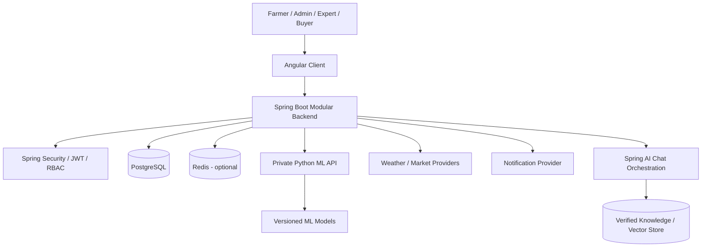

# System Architecture

## Logical components

## Trust boundaries
- Browser is an untrusted client. Enforce all authorization on the backend.
- Python inference endpoints are internal and must not be publicly exposed to the browser.
- LLM tools must call authorized backend services; never allow raw database access or authorization bypass.
- External provider data must be validated, timestamped and attributed.

## Spring Boot backend (`backend/`)
- Spring Boot 4.1.2 modular monolith (ADR-0001, ADR-0002), package root `com.agrigenius`.
- Shared code: `common/error` (problem+json errors), `common/security` (JSON 401/403), `common/web` (`X-Request-Id` correlation), `config` (security, CORS, OpenAPI).
- Feature modules arrive as packages with `api` (controllers, DTOs) → `application` (services, transactions) → `domain` (entities) → `infrastructure` (repositories, adapters). Modules talk through `application` services only, never another module's repositories.
- Persistence: PostgreSQL 17 + pgvector via JPA/Hibernate (`ddl-auto=validate`, `open-in-view=false`, UTC). Flyway owns the schema; `clean` is disabled.
- Security: stateless, CSRF off (no cookies), deny by default. Public: health, liveness, readiness, info, and API docs in the `local` profile only. Everything else returns 401 until JWT (Milestone 2). CORS allowlist from `CORS_ALLOWED_ORIGINS` for `/api/**`.
- ML integration: `integration/ml/MlServiceClient` (port) with a `RestClient` adapter, 2 s connect / 5 s read timeouts. The `mlService` health component reports `DEGRADED` (never `DOWN`) when the ML service is unreachable and is excluded from readiness, so the backend keeps serving non-ML features.
- Anonymous health results are cached for 10 s so public health checks cannot be used to flood the database or ML service.

## Python ML service (`ml-service/`)
- FastAPI application created by `create_app()` in `app/main.py`; feature routers live under `app/api/routes/`, configuration in `app/core/config.py`.
- Configuration comes only from `ML_*` environment variables (optionally `ml-service/.env`, gitignored) and is validated at startup.
- Binds to `127.0.0.1:8001` by default so it is unreachable from other machines. Changing `ML_HOST` to a non-loopback address must be paired with network isolation and service-to-service authentication.
- Currently exposes only `GET /health` (liveness). No models are loaded yet.
- OpenAPI docs are disabled when `ML_APP_ENV=production`.

## Architecture decision records
Create `docs/architecture/decisions/ADR-NNNN-*.md` for significant choices (ADR-0001 modular monolith, ADR-0002 Spring Boot 4.1). Each ADR should include context, decision, alternatives, consequences and date.
