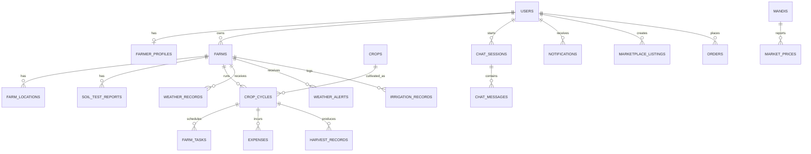
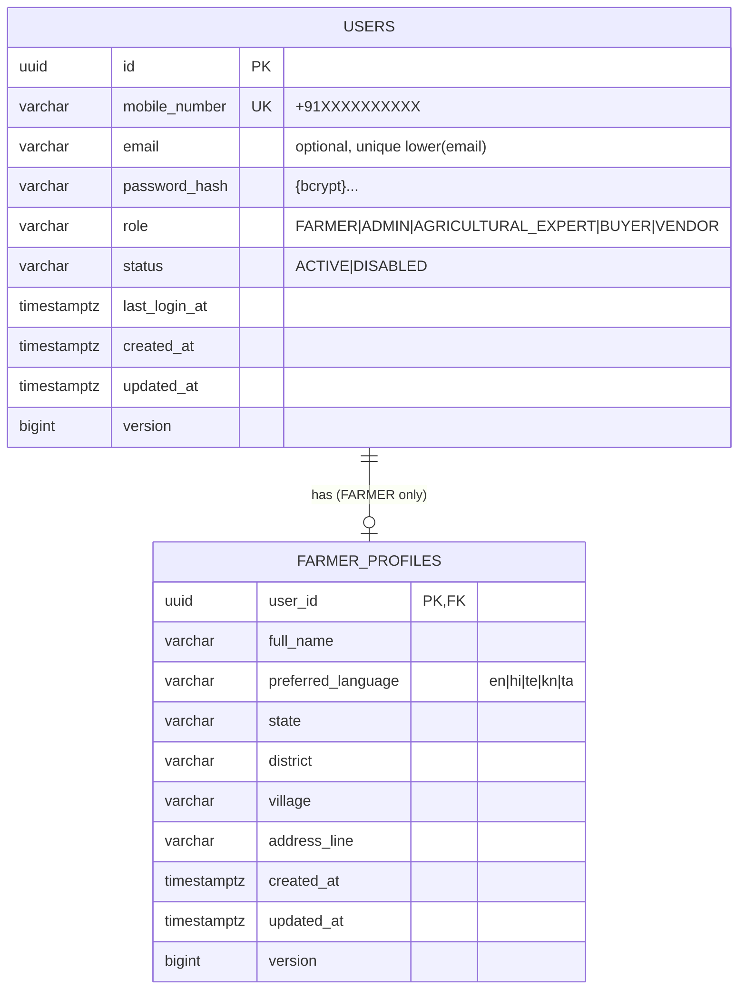

# Database ERD – Draft

This is a domain-level draft. Confirm keys, optionality, cardinality, indexes, deletion behavior and audit requirements before creating migrations.



## Entity inventory
users, farmer_profiles, farms, farm_locations, soil_details, soil_test_reports, crops, crop_recommendations, crop_cycles, farm_tasks, weather_records, weather_alerts, market_prices, mandis, disease_reports, irrigation_records, chat_sessions, chat_messages, notifications, expenses, harvest_records, government_schemes, marketplace_listings, buyers, orders, audit_logs.

## Rules
- A farmer can own multiple farms.
- A farm can have multiple soil reports and crop cycles.
- A crop can be used by multiple crop cycles.
- A crop cycle can have multiple expenses and harvest records.
- A farmer can have multiple chat sessions and a session multiple messages.
- A farm can have multiple weather alerts.
- Store coordinates per farm location.
- Use Flyway migrations; never rely on Hibernate auto-DDL for production schema changes.

## Applied migrations

| Version | File | Effect |
|---|---|---|
| V1 | `backend/src/main/resources/db/migration/V1__enable_pgvector.sql` | `CREATE EXTENSION IF NOT EXISTS vector` (no-op on the local DB, which already had it). No tables. |
| V2 | `backend/src/main/resources/db/migration/V2__create_users_and_farmer_profiles.sql` | Creates `users` and `farmer_profiles` (Milestone 2, in progress). |
| Callback | `backend/src/main/resources/db/migration/afterMigrate.sql` | Runs after **every** migrate as the schema owner: creates or updates the least-privilege role `${appDbUser}` (`LOGIN`, password from `DB_PASSWORD`), grants `USAGE` on schema `public`, `SELECT, INSERT, UPDATE, DELETE` on all tables and `USAGE, SELECT` on all sequences. Skipped when `agrigenius.database.app-role.manage=false` (`DB_MANAGE_APP_ROLE=false`). |

Flyway also creates `flyway_schema_history`. Hibernate runs with `ddl-auto=validate` and Flyway `clean` is disabled. Flyway connects as the schema owner (`POSTGRES_USER`); the running application connects as the app role (`DB_USERNAME`), which cannot create, alter or drop tables.

## Identity and farmer profile (V2)



Exact DDL (from `V2__create_users_and_farmer_profiles.sql`):

```sql
CREATE TABLE users (
    id              UUID PRIMARY KEY DEFAULT gen_random_uuid(),
    mobile_number   VARCHAR(13)  NOT NULL,           -- normalised +91XXXXXXXXXX
    email           VARCHAR(254),                    -- optional, stored lowercase
    password_hash   VARCHAR(100) NOT NULL,           -- {bcrypt}$2a$12$...
    role            VARCHAR(30)  NOT NULL
        CONSTRAINT ck_users_role CHECK (role IN ('FARMER', 'ADMIN', 'AGRICULTURAL_EXPERT', 'BUYER', 'VENDOR')),
    status          VARCHAR(20)  NOT NULL DEFAULT 'ACTIVE'
        CONSTRAINT ck_users_status CHECK (status IN ('ACTIVE', 'DISABLED')),
    last_login_at   TIMESTAMPTZ,
    created_at      TIMESTAMPTZ  NOT NULL DEFAULT now(),
    updated_at      TIMESTAMPTZ  NOT NULL DEFAULT now(),
    version         BIGINT       NOT NULL DEFAULT 0,
    CONSTRAINT uk_users_mobile_number UNIQUE (mobile_number),
    CONSTRAINT ck_users_mobile_format CHECK (mobile_number ~ '^\+91[6-9][0-9]{9}$'),
    CONSTRAINT ck_users_email_lowercase CHECK (email IS NULL OR email = lower(email))
);

CREATE UNIQUE INDEX uk_users_email ON users (email) WHERE email IS NOT NULL;

CREATE TABLE farmer_profiles (
    user_id             UUID PRIMARY KEY
        CONSTRAINT fk_farmer_profiles_user REFERENCES users (id) ON DELETE CASCADE,
    full_name           VARCHAR(100) NOT NULL,
    preferred_language  VARCHAR(5)   NOT NULL
        CONSTRAINT ck_farmer_profiles_language CHECK (preferred_language IN ('en', 'hi', 'te', 'kn', 'ta')),
    state               VARCHAR(60),
    district            VARCHAR(60),
    village             VARCHAR(100),
    address_line        VARCHAR(200),
    created_at          TIMESTAMPTZ  NOT NULL DEFAULT now(),
    updated_at          TIMESTAMPTZ  NOT NULL DEFAULT now(),
    version             BIGINT       NOT NULL DEFAULT 0
);
```

Design notes:
- UUID keys so ids and account counts cannot be guessed.
- One role per user (decision D4); a `user_roles` table can replace the column later with a simple migration.
- `farmer_profiles` is 1:1 with `users` and shares its key; deleting a user deletes the profile.
- `version` columns support optimistic locking.
- Check constraints also enforce the normalised mobile format (`+91` + 10 digits starting 6-9) and lowercase emails, so the unique index on `email` is case-insensitive in practice.
- Profile image, coordinates (belong to `farm_locations`), farms, refresh tokens and password-reset tables are not part of V2.
