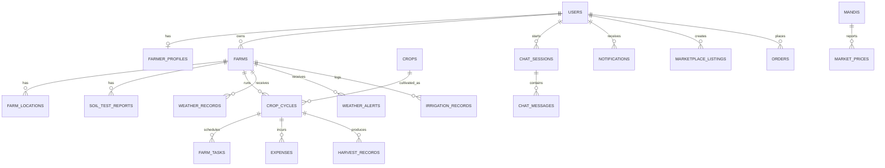

# Database ERD – Draft

This is a domain-level draft. Confirm keys, optionality, cardinality, indexes, deletion behavior and audit requirements before creating migrations.

## Entity inventory
users, farmer_profiles, farms, farm_locations, soil_details, soil_test_reports, crops, crop_recommendations, crop_cycles, farm_tasks, weather_records, weather_alerts, market_prices, mandis, disease_reports, irrigation_records, chat_sessions, chat_messages, notifications, expenses, harvest_records, government_schemes, marketplace_listings, buyers, orders, audit_logs.

## Rules
- A farmer can own multiple farms.
- A farm can have multiple soil reports and crop cycles.
- A crop can be used by multiple crop cycles.
- A crop cycle can have multiple expenses and harvest records.
- A farmer can have multiple chat sessions and a session multiple messages.
- A farm can have multiple weather alerts.
- Store coordinates per farm location.
- Use Flyway migrations; never rely on Hibernate auto-DDL for production schema changes.
