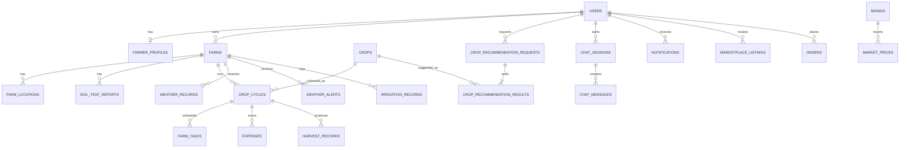
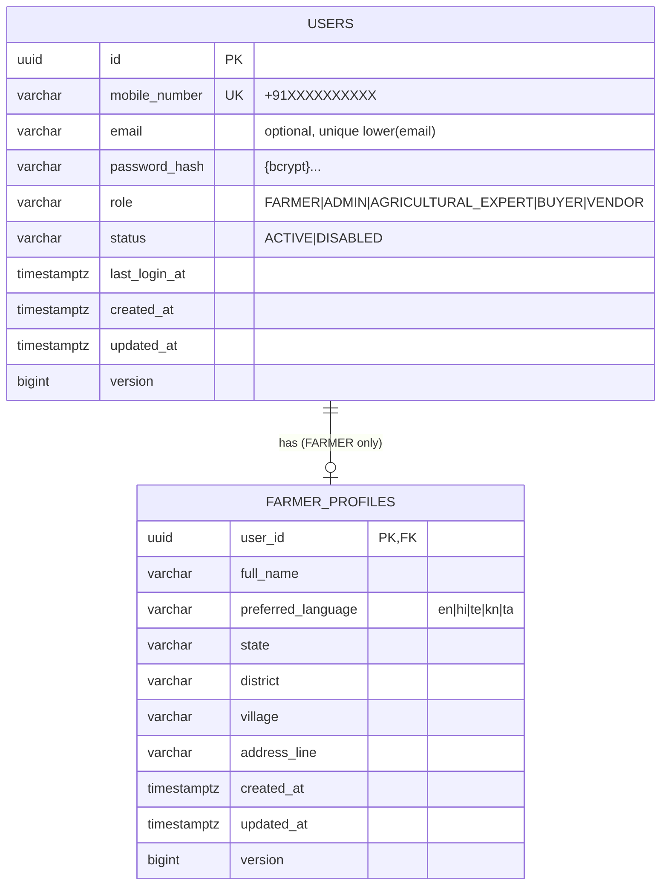
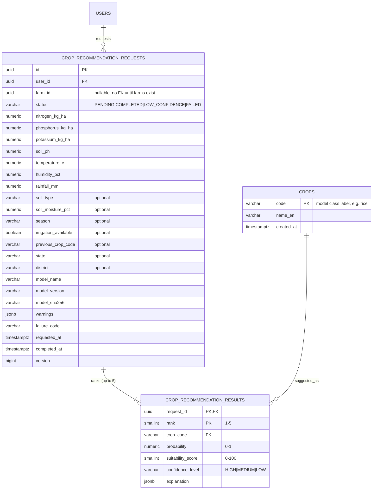
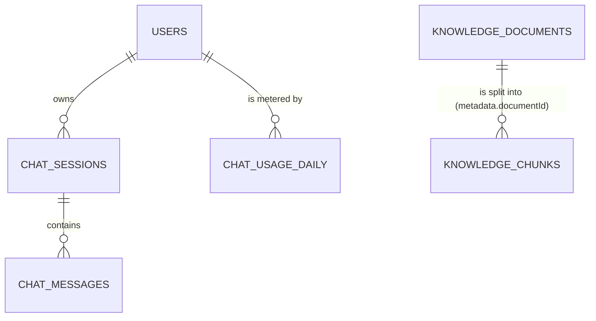

# Database ERD – Draft

This is a domain-level draft. Confirm keys, optionality, cardinality, indexes, deletion behavior and audit requirements before creating migrations.



## Entity inventory
users, farmer_profiles, farms, farm_locations, soil_details, soil_test_reports, crops, crop_recommendations, crop_cycles, farm_tasks, weather_records, weather_alerts, market_prices, mandis, disease_reports, irrigation_records, chat_sessions, chat_messages, notifications, expenses, harvest_records, government_schemes, marketplace_listings, buyers, orders, audit_logs.

## Rules
- A farmer can own multiple farms.
- A farm can have multiple soil reports and crop cycles.
- A crop can be used by multiple crop cycles.
- A crop cycle can have multiple expenses and harvest records.
- A farmer can have multiple chat sessions and a session multiple messages.
- A farm can have multiple weather alerts.
- Store coordinates per farm location.
- Use Flyway migrations; never rely on Hibernate auto-DDL for production schema changes.

## Applied migrations

| Version | File | Effect |
|---|---|---|
| V1 | `backend/src/main/resources/db/migration/V1__enable_pgvector.sql` | `CREATE EXTENSION IF NOT EXISTS vector` (no-op on the local DB, which already had it). No tables. |
| V2 | `backend/src/main/resources/db/migration/V2__create_users_and_farmer_profiles.sql` | Creates `users` and `farmer_profiles` (Milestone 2, in progress). |
| V3 | `backend/src/main/resources/db/migration/V3__crop_recommendations.sql` | Creates `crops` (seeded with the model's 22 crop codes), `crop_recommendation_requests` and `crop_recommendation_results` (Milestone 3, in progress). |
| Callback | `backend/src/main/resources/db/migration/afterMigrate.sql` | Runs after **every** migrate as the schema owner: creates or updates the least-privilege role `${appDbUser}` (`LOGIN`, password from `DB_PASSWORD`), grants `USAGE` on schema `public`, `SELECT, INSERT, UPDATE, DELETE` on all tables and `USAGE, SELECT` on all sequences. Skipped when `agrigenius.database.app-role.manage=false` (`DB_MANAGE_APP_ROLE=false`). |

Flyway also creates `flyway_schema_history`. Hibernate runs with `ddl-auto=validate` and Flyway `clean` is disabled. Flyway connects as the schema owner (`POSTGRES_USER`); the running application connects as the app role (`DB_USERNAME`), which cannot create, alter or drop tables.

## Identity and farmer profile (V2)



Exact DDL (from `V2__create_users_and_farmer_profiles.sql`):

```sql
CREATE TABLE users (
    id              UUID PRIMARY KEY DEFAULT gen_random_uuid(),
    mobile_number   VARCHAR(13)  NOT NULL,           -- normalised +91XXXXXXXXXX
    email           VARCHAR(254),                    -- optional, stored lowercase
    password_hash   VARCHAR(100) NOT NULL,           -- {bcrypt}$2a$12$...
    role            VARCHAR(30)  NOT NULL
        CONSTRAINT ck_users_role CHECK (role IN ('FARMER', 'ADMIN', 'AGRICULTURAL_EXPERT', 'BUYER', 'VENDOR')),
    status          VARCHAR(20)  NOT NULL DEFAULT 'ACTIVE'
        CONSTRAINT ck_users_status CHECK (status IN ('ACTIVE', 'DISABLED')),
    last_login_at   TIMESTAMPTZ,
    created_at      TIMESTAMPTZ  NOT NULL DEFAULT now(),
    updated_at      TIMESTAMPTZ  NOT NULL DEFAULT now(),
    version         BIGINT       NOT NULL DEFAULT 0,
    CONSTRAINT uk_users_mobile_number UNIQUE (mobile_number),
    CONSTRAINT ck_users_mobile_format CHECK (mobile_number ~ '^\+91[6-9][0-9]{9}$'),
    CONSTRAINT ck_users_email_lowercase CHECK (email IS NULL OR email = lower(email))
);

CREATE UNIQUE INDEX uk_users_email ON users (email) WHERE email IS NOT NULL;

CREATE TABLE farmer_profiles (
    user_id             UUID PRIMARY KEY
        CONSTRAINT fk_farmer_profiles_user REFERENCES users (id) ON DELETE CASCADE,
    full_name           VARCHAR(100) NOT NULL,
    preferred_language  VARCHAR(5)   NOT NULL
        CONSTRAINT ck_farmer_profiles_language CHECK (preferred_language IN ('en', 'hi', 'te', 'kn', 'ta')),
    state               VARCHAR(60),
    district            VARCHAR(60),
    village             VARCHAR(100),
    address_line        VARCHAR(200),
    created_at          TIMESTAMPTZ  NOT NULL DEFAULT now(),
    updated_at          TIMESTAMPTZ  NOT NULL DEFAULT now(),
    version             BIGINT       NOT NULL DEFAULT 0
);
```

Design notes:
- UUID keys so ids and account counts cannot be guessed.
- One role per user (decision D4); a `user_roles` table can replace the column later with a simple migration.
- `farmer_profiles` is 1:1 with `users` and shares its key; deleting a user deletes the profile.
- `version` columns support optimistic locking.
- Check constraints also enforce the normalised mobile format (`+91` + 10 digits starting 6-9) and lowercase emails, so the unique index on `email` is case-insensitive in practice.
- Profile image, coordinates (belong to `farm_locations`), farms, refresh tokens and password-reset tables are not part of V2.

## Crop recommendation (V3)

Milestone 3, in progress. Design: ADR-0005.



```sql
-- AI crop recommendation (Phase 1, Milestone 3).
-- crops: reference data; codes are the crop model's class labels.
-- Requests keep a typed snapshot of every input plus model identity for traceability;
-- failed requests are kept too (status FAILED + failure_code).

CREATE TABLE crops (
    code        VARCHAR(40) PRIMARY KEY,
    name_en     VARCHAR(80) NOT NULL,
    created_at  TIMESTAMPTZ NOT NULL DEFAULT now()
);

INSERT INTO crops (code, name_en) VALUES
    ('apple', 'Apple'),
    ('banana', 'Banana'),
    ('blackgram', 'Black gram'),
    ('chickpea', 'Chickpea'),
    ('coconut', 'Coconut'),
    ('coffee', 'Coffee'),
    ('cotton', 'Cotton'),
    ('grapes', 'Grapes'),
    ('jute', 'Jute'),
    ('kidneybeans', 'Kidney beans'),
    ('lentil', 'Lentil'),
    ('maize', 'Maize'),
    ('mango', 'Mango'),
    ('mothbeans', 'Moth beans'),
    ('mungbean', 'Mung bean'),
    ('muskmelon', 'Muskmelon'),
    ('orange', 'Orange'),
    ('papaya', 'Papaya'),
    ('pigeonpeas', 'Pigeon peas'),
    ('pomegranate', 'Pomegranate'),
    ('rice', 'Rice'),
    ('watermelon', 'Watermelon');

CREATE TABLE crop_recommendation_requests (
    id                    UUID PRIMARY KEY,
    user_id               UUID         NOT NULL
        CONSTRAINT fk_crop_rec_requests_user REFERENCES users (id) ON DELETE CASCADE,
    farm_id               UUID,        -- foreign key added once farms exist
    status                VARCHAR(20)  NOT NULL
        CONSTRAINT ck_crop_rec_requests_status CHECK (status IN ('PENDING', 'COMPLETED', 'LOW_CONFIDENCE', 'FAILED')),
    nitrogen_kg_ha        NUMERIC(6, 2) NOT NULL CONSTRAINT ck_crop_rec_n CHECK (nitrogen_kg_ha BETWEEN 0 AND 300),
    phosphorus_kg_ha      NUMERIC(6, 2) NOT NULL CONSTRAINT ck_crop_rec_p CHECK (phosphorus_kg_ha BETWEEN 0 AND 300),
    potassium_kg_ha       NUMERIC(6, 2) NOT NULL CONSTRAINT ck_crop_rec_k CHECK (potassium_kg_ha BETWEEN 0 AND 300),
    soil_ph               NUMERIC(4, 2) NOT NULL CONSTRAINT ck_crop_rec_ph CHECK (soil_ph BETWEEN 3 AND 10),
    temperature_c         NUMERIC(5, 2) NOT NULL CONSTRAINT ck_crop_rec_temp CHECK (temperature_c BETWEEN -5 AND 55),
    humidity_pct          NUMERIC(5, 2) NOT NULL CONSTRAINT ck_crop_rec_humidity CHECK (humidity_pct BETWEEN 0 AND 100),
    rainfall_mm           NUMERIC(7, 2) NOT NULL CONSTRAINT ck_crop_rec_rainfall CHECK (rainfall_mm BETWEEN 0 AND 5000),
    soil_type             VARCHAR(30)
        CONSTRAINT ck_crop_rec_soil_type CHECK (soil_type IN
            ('SANDY', 'LOAMY', 'CLAY', 'SILT', 'BLACK', 'RED', 'LATERITE', 'ALLUVIAL')),
    soil_moisture_pct     NUMERIC(5, 2) CONSTRAINT ck_crop_rec_moisture CHECK (soil_moisture_pct BETWEEN 0 AND 100),
    season                VARCHAR(10)
        CONSTRAINT ck_crop_rec_season CHECK (season IN ('KHARIF', 'RABI', 'ZAID')),
    irrigation_available  BOOLEAN,
    previous_crop_code    VARCHAR(40)
        CONSTRAINT fk_crop_rec_previous_crop REFERENCES crops (code),
    state                 VARCHAR(60),
    district              VARCHAR(60),
    model_name            VARCHAR(80),
    model_version         VARCHAR(40),
    model_sha256          VARCHAR(64),
    model_data_label      VARCHAR(40),
    warnings              JSONB        NOT NULL DEFAULT '[]',
    failure_code          VARCHAR(40),
    requested_at          TIMESTAMPTZ  NOT NULL,
    completed_at          TIMESTAMPTZ,
    version               BIGINT       NOT NULL DEFAULT 0
);

CREATE INDEX ix_crop_rec_requests_user_time ON crop_recommendation_requests (user_id, requested_at DESC);

CREATE TABLE crop_recommendation_results (
    request_id         UUID         NOT NULL
        CONSTRAINT fk_crop_rec_results_request REFERENCES crop_recommendation_requests (id) ON DELETE CASCADE,
    rank               SMALLINT     NOT NULL CONSTRAINT ck_crop_rec_results_rank CHECK (rank BETWEEN 1 AND 5),
    crop_code          VARCHAR(40)  NOT NULL CONSTRAINT fk_crop_rec_results_crop REFERENCES crops (code),
    probability        NUMERIC(5, 4) NOT NULL CONSTRAINT ck_crop_rec_results_probability CHECK (probability BETWEEN 0 AND 1),
    suitability_score  SMALLINT     NOT NULL CONSTRAINT ck_crop_rec_results_score CHECK (suitability_score BETWEEN 0 AND 100),
    confidence_level   VARCHAR(10)  NOT NULL
        CONSTRAINT ck_crop_rec_results_confidence CHECK (confidence_level IN ('HIGH', 'MEDIUM', 'LOW')),
    explanation        JSONB        NOT NULL,
    CONSTRAINT pk_crop_recommendation_results PRIMARY KEY (request_id, rank)
);
```

The SQL above is the applied migration `V3__crop_recommendations.sql`. Differences from the original plan: an added `model_data_label` column (the API returns it) and `model_sha256` as `VARCHAR(64)` instead of `CHAR(64)` (Hibernate schema validation).

Design notes:
- The input snapshot uses typed columns with units in their names, so recommendations can be queried and audited (PROJECT_SPEC §3.2 traceability).
- `farm_id` is nullable with no foreign key until the farms module exists (decision Q2); a later migration adds the constraint.
- Failed requests are kept (`status = FAILED`, `failure_code`) to trace ML outages; they have no result rows.
- `model_name`, `model_version` and `model_sha256` tie each result to the exact artifact that produced it.
- The application role gets read/write on these tables through the `afterMigrate.sql` callback; `crops` is reference data seeded by the migration.
- Crop names in other languages and agronomy facts (water needs, duration) are added later, only from cited sources.


## Agriculture chatbot (V4, planned until the migration lands)



```sql
CREATE TABLE chat_sessions (
  id UUID PRIMARY KEY, user_id UUID NOT NULL REFERENCES users(id) ON DELETE CASCADE,
  title VARCHAR(120), language VARCHAR(5) NOT NULL CHECK (language IN ('en','hi','te','kn','ta')),
  status VARCHAR(10) NOT NULL DEFAULT 'ACTIVE' CHECK (status IN ('ACTIVE','ARCHIVED')),
  message_count INT NOT NULL DEFAULT 0, created_at TIMESTAMPTZ NOT NULL, last_message_at TIMESTAMPTZ,
  version BIGINT NOT NULL DEFAULT 0);
CREATE INDEX ix_chat_sessions_user ON chat_sessions (user_id, last_message_at DESC);

CREATE TABLE chat_messages (
  id UUID PRIMARY KEY, session_id UUID NOT NULL REFERENCES chat_sessions(id) ON DELETE CASCADE,
  user_id UUID NOT NULL,                       -- denormalised for owner-scoped queries
  role VARCHAR(10) NOT NULL CHECK (role IN ('USER','ASSISTANT')),
  status VARCHAR(12) NOT NULL CHECK (status IN ('OK','FAILED','REFUSED','NO_SOURCES')),
  content TEXT NOT NULL CHECK (length(content) <= 8000),
  sources JSONB NOT NULL DEFAULT '[]',         -- [{documentId, title, publisher, url, chunk}]
  tools_used JSONB NOT NULL DEFAULT '[]',      -- names + outcome only, never data
  model VARCHAR(60), input_tokens INT, output_tokens INT, cache_read_tokens INT, latency_ms INT,
  created_at TIMESTAMPTZ NOT NULL);
CREATE INDEX ix_chat_messages_session ON chat_messages (session_id, created_at);

CREATE TABLE knowledge_documents (
  id UUID PRIMARY KEY, title VARCHAR(300) NOT NULL, publisher VARCHAR(200) NOT NULL,
  source_url VARCHAR(500) NOT NULL, licence VARCHAR(60) NOT NULL, language VARCHAR(5) NOT NULL,
  crops TEXT[] NOT NULL DEFAULT '{}', topics TEXT[] NOT NULL DEFAULT '{}',
  sha256 CHAR(64) NOT NULL UNIQUE, status VARCHAR(10) NOT NULL CHECK (status IN ('ACTIVE','RETIRED')),
  chunk_count INT NOT NULL, ingested_at TIMESTAMPTZ NOT NULL);

CREATE TABLE knowledge_chunks (                -- the Spring AI PgVectorStore table (custom name)
  id UUID PRIMARY KEY, content TEXT NOT NULL, metadata JSONB NOT NULL,
  embedding vector(384) NOT NULL);
CREATE INDEX ix_knowledge_chunks_hnsw ON knowledge_chunks USING hnsw (embedding vector_cosine_ops);

CREATE TABLE chat_usage_daily (
  user_id UUID NOT NULL REFERENCES users(id) ON DELETE CASCADE, day DATE NOT NULL,
  requests INT NOT NULL, input_tokens BIGINT NOT NULL, output_tokens BIGINT NOT NULL,
  PRIMARY KEY (user_id, day));
```

Design notes:
- `chat_messages.user_id` duplicates the session owner so every message query can filter by owner directly.
- Deleting a session or a user cascades to messages and usage rows.
- `knowledge_chunks` is created by Flyway, not Spring AI (`initialize-schema=false`). Its 384 dimensions match `intfloat/multilingual-e5-small` (ADR-0006); a different embedding model needs a migration and a full re-ingest.
- Chunk metadata (`documentId`, `chunkIndex`, `language`, `crops`, `topics`, `licence`, `title`, `url`) supports filtering and source attribution.
- Only the ingestion command writes the knowledge tables; the chat endpoints read them.
- The application role gets data-only access through the existing `afterMigrate.sql` callback.
